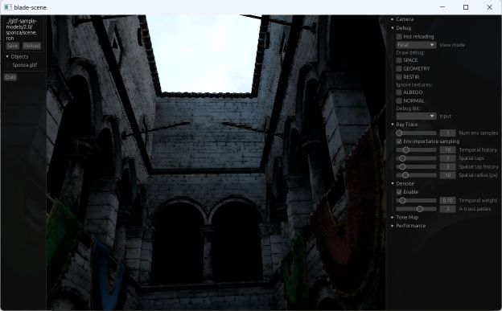

# Blade Render

[](https://docs.rs/blade-render)
[](https://crates.io/crates/blade-render)

Rasterized and ray-traced rendering based on [blade-graphics](https://crates.io/crates/blade-graphics) and [blade-asset](https://crates.io/crates/blade-asset).



## Platforms

The rasterizer supports the portable graphics profile, including WebGL2. The
ray tracer requires a backend and device with ray-query support.

## Denoiser diagnostics

From the workspace root, capture matched vehicle views and profile the
renderer on a working ray-tracing GPU:

```sh
BLADE_CAPTURE_VEHICLE=1 BLADE_PROFILE_GPU=1 cargo test --test gpu_examples compare_vehicle_denoising -- --ignored --nocapture --test-threads=1
```

The manual test writes PNGs under `target/denoiser-diagnostic/WIDTHxHEIGHT/`:
raw lighting, the normal engine denoiser, a history-preserved control, and an
accumulated reference. It checks reference error and residual noise, including
that resetting debug statistics each frame does not discard SVGF history.
It requires `BLADE_CAPTURE_VEHICLE=1`, including when running ignored tests,
so CI does not run captures. It does not update golden images.

For short timing runs, set `BLADE_CAPTURE_CASE=current-engine`,
`BLADE_CAPTURE_SIZE=1280x832`, and `BLADE_CAPTURE_FRAMES=16`.
`BLADE_CAPTURE_PASSES` and `BLADE_CAPTURE_TAPS` override spatial passes and
ReSTIR reuse taps. Omit `BLADE_PROFILE_GPU` to measure without GPU counters.
Set `BLADE_CAPTURE_MOTION=1` for a moving vehicle with a following camera, or
`BLADE_CAPTURE_MOTION=turn` to also rotate and nonuniformly scale the vehicle.
These cases verify ground/vehicle motion vectors and previous-hit depths against
CPU reprojection and check noise reduction in newly exposed regions.
Compare under the same power/load conditions; this controlled offscreen fixture
excludes game physics, presentation, and UI, so its timings are not game FPS.

For a short scene-update profile using the vehicle wheel assets:

```sh
BLADE_PROFILE_VEHICLE=1 cargo test --test gpu_examples animated_blas_memory_stays_bounded -- --ignored --nocapture
```

This measures rigid-instance updates alongside skinned/refitted geometry over
32 frames at 16×16, not full-resolution vehicle FPS. Add `BLADE_PROFILE_GPU=1`
for per-pass counters; omit it for wall timing without counter-resolution overhead.

## Shader sources / shipping

Canonical WGSL lives in this crate’s `code/` directory. It is listed in
`Cargo.toml` `include` so **crates.io** packages contain it; **git** and **path**
dependencies already see the full tree. Do **not** copy these files into every
game repo.

### Dev and CI (native)

Set Engine `config.shader_path` from [`shader_dir()`](https://docs.rs/blade-render/latest/blade_render/fn.shader_dir.html):

```rust
config.shader_path = blade_render::shader_dir()
    .to_string_lossy()
    .into_owned();
```

`shader_dir()` is `env!("CARGO_MANIFEST_DIR")/code` for **blade-render** (not the
game). That path works with git (`~/.cargo/git/checkouts/.../blade-render/code`),
path, and crates.io registry unpacks during `cargo run` / CI on the build machine.
The Blade pin (git rev or crates.io version) **is** the shader version.

### Game-only overrides

Keep thin overlays in the game (for example a custom `raster.wgsl`). A common
native pattern: copy stock `shader_dir()` into a local cache, then copy overlay
files on top, and point `shader_path` at the cache. Do not vendor the full
stock tree.

### WASM (and other no-filesystem targets)

Runtime cannot read `shader_dir()` from disk. In the game’s `build.rs`, resolve
blade-render’s `code/` via `cargo metadata` (find the `blade-render` package’s
`manifest_path`, take the sibling `code/`), optionally merge overlays into
`OUT_DIR`, then `include_dir!` that tree into Blade’s VFS. Mount under the same
absolute paths `shader_dir()` returns so `config.shader_path` stays one string
for native and WASM. Reference: redline / geofront after their `shader_dir`
migrations.

### Shipped native binaries

`shader_dir()` embeds a **build-machine** absolute path. A release binary on
another machine will not find `~/.cargo/...`. For packaging either:

1. **Embed** WGSL the same way as WASM and load from the VFS, or
2. **Install** `code/` (plus overlays) next to the executable and set
   `shader_path` to that install directory.

Treat “`cargo run` works” as necessary but not sufficient for release.

## Skeletal animation

The renderer's glTF model contains only the geometry-side skin bindings. Clip
data, hierarchy evaluation, playback, and interpolation belong to a separate
animation model in `blade-engine`. The renderer receives only the evaluated
result:

```rust
let mut object = blade_render::Object::from(model_handle);
object.pose = Some(pose_evaluated_by_the_animation_system);

// After the frame is submitted, preserve what was rendered before the next pose.
object.flip();
object.pose = Some(next_pose_evaluated_by_the_animation_system);
```

`pose` and `prev_pose` are public, just like `transform` and `prev_transform`.
`Object::flip` copies both current values into the previous-frame slots so the
ray tracer can generate motion vectors from the state that produced the previous
pixels. Applications using `blade-engine::Engine` can instead call
`Engine::set_animation`; the engine loads a separate animation component,
advances and evaluates its player, and fills both poses when it submits render
objects.

Joint indices are compacted per mesh primitive and stored as 8-bit values with
unorm8 weights (8 bytes total). A primitive may use up to 64 distinct joints,
matching the portable WebGL2 uniform-block limit. Pose node transforms and the
raster joint palette are affine 3x4 matrices (`blade_graphics::Transform` /
uniform `mat3x4`), 48 bytes each.

The 3.4 KiB fixture at `tests/assets/animated_skin.glb` contains two joints and
one rotation-and-scale clip. Its fixed-keyframe raster reference can be run on
any supported GPU backend:

```bash
cargo test --test gpu_examples snapshot_animated_skin -- --ignored --nocapture
```

Set `BLADE_UPDATE_SNAPSHOTS=1` to regenerate the reference image after an
intentional rendering change.
